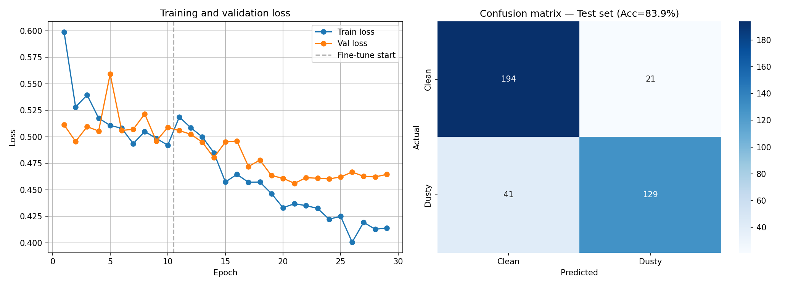

# SolarSense — AI-Based Solar Panel Dust Detection

SolarSense is an AI-powered solar panel inspection and maintenance system that analyzes uploaded images and videos to classify solar panels as **Clean** or **Dusty**. It uses a MobileNetV2 deep learning model to support panel condition assessment and provide maintenance recommendations.

## Overview

Dust accumulation on solar panels can reduce their ability to generate electricity. SolarSense helps users identify potentially dusty panels through image and video analysis, visualize suspected dust regions, and make informed maintenance decisions.

## Key Features

- **AI-Based Classification:** Classifies solar panel images as Clean or Dusty using MobileNetV2.
- **Image Analysis:** Upload a solar panel image for AI prediction.
- **Video Analysis:** Upload a video to analyze solar panel footage.
- **Visual Explanations:** Uses Grad-CAM heatmaps to highlight image regions influencing the classifier's prediction.
- **Dust Region Segmentation:** Supports an optional U-Net model for dust-region segmentation when a trained segmentation model is available.
- **Prediction Confidence:** Displays the model's confidence score for its classification.
- **Maintenance Recommendations:** Provides guidance based on the predicted panel condition.
- **Efficiency-Loss Estimation:** Supports software-based estimates, with the method and assumptions identified in the results.
- **Web Dashboard:** Provides a web interface for accessing detection and maintenance-related features.

## How It Works

1. **Upload:** The user uploads a solar panel image or video through the web interface.
2. **Preprocessing:** The application prepares image frames for the model using resizing and normalization.
3. **AI Classification:** The MobileNetV2 model predicts whether the panel is Clean or Dusty.
4. **Visual Analysis:** Grad-CAM generates a heatmap to show image regions that influenced the classification. If a trained segmentation model is available, it can provide a dust-region mask.
5. **Results:** The application presents the predicted class, confidence score, and available visual results.
6. **Maintenance Guidance:** SolarSense provides a maintenance recommendation based on the detected condition.

**Note:** Grad-CAM highlights influential image regions; it does not independently measure the exact percentage of dust. Any dust coverage or efficiency-loss estimate should be interpreted according to the method used.
###Login Page

 

### Video Detection

Upload a solar panel image and view the original image alongside the AI analysis.


**Prediction and heatmap results**


### Maintenance Page

View maintenance recommendations for detected dusty solar panels.


### Inspection History

Review previous solar panel inspections and their results.


### photo Detection

Upload a video containing solar panel footage for analysis.

**photo upload interface**

[SolarSense photo Page](Screenshot%20%28330%29.png)

**photo analysis results**


`[SolarSense photo Page](Screenshot%20%28331%29.png)

To display these images on GitHub, create the `docs/images/` folder in your repository and place the corresponding screenshots there. Replace the example filenames with your actual screenshot filenames.

## Model Training and Evaluation

SolarSense uses a MobileNetV2 feature extractor with a custom classification head to predict two classes: Clean and Dusty.

### Evaluation Setup

| Parameter | Value |
|---|---|
| Model | MobileNetV2 |
| Classes | Clean, Dusty |
| Test samples | 680 |
| Clean samples | 337 |
| Dusty samples | 343 |
| Split | Stratified 80/20 |
| Random seed | 42 |
| Positive class for metrics | Dusty |

*The 680 samples are the held-out test set. Confirm that this matches the split used by your evaluation script.*

### Test Results

| Metric | Score |
|---|---:|
| Accuracy | 81.47% |
| Dusty Precision | 90.04% |
| Dusty Recall | 79.14% |
| Dusty F1-score | 79.48% |

### Confusion Matrix

Rows represent the actual class; columns represent the predicted class.

| Actual / Predicted | Clean | Dusty |
|---|---:|---:|
| Clean | 310 | 27 |
| Dusty | 99 | 244 |

### Understanding the Results

- **Accuracy — 81.47%:** The model correctly classified 554 out of 680 test samples.
- **Precision — 90.04%:** Of the samples predicted as Dusty, approximately 90% were actually Dusty.
- **Recall — 71.14%:** The model identified approximately 71% of all actual Dusty samples.
- **F1-score — 79.48%:** Summarizes the balance between Dusty precision and recall.

The results show strong precision for Dusty predictions, while improving the detection of dusty panels that are currently missed is an important area for future work.

### Training and Evaluation Graphs

Add the graphs generated by your training and evaluation scripts here.

**Training and validation loss and confusion matrix**




## Technology Stack

- **Language:** Python
- **Deep Learning:** PyTorch
- **Model:** MobileNetV2
- **Web Framework:** Flask
- **Image and Video Processing:** OpenCV
- **Visualization:** Grad-CAM and optional U-Net segmentation
- **Frontend:** HTML, CSS, JavaScript

## Project Structure

```text
SolarSense/
├── app.py
├── model.py
├── model.pth
├── gradcam.py
├── segmentation.py
├── efficiency_model.py
├── dust_level.py
├── video_processor.py
├── train.py
├── train_segmentation.py
├── annotate_masks.py
├── test.py
├── requirements.txt
├── templates/
├── static/
├── tests/
├── docs/
│   └── images/
└── README.md
```

## Installation and Usage

### 1. Clone the Repository

```bash
git clone https://github.com/Alkha09/solarpaneldust-detect.git
cd solarpaneldust-detect
```

### 2. Create a Virtual Environment

```bash
python -m venv venv
```

Activate it on Windows:

```bash
venv\Scripts\activate
```

### 3. Install Dependencies

```bash
pip install -r requirements.txt
```

### 4. Start the Application

```bash
python app.py
```

Open the local address shown in the terminal, commonly:

`http://127.0.0.1:5000`

Ensure the required model checkpoint is present before running predictions.

## Efficiency-Loss Estimation

SolarSense can estimate potential efficiency loss using available panel measurements or a provisional software-based estimate.

When measured power and irradiance data are unavailable, a simplified estimate may be used:

**Estimated loss (%) = 0.2 × estimated dust coverage (%)**

This provisional assumption caps the estimated loss at 20% for 100% dust coverage. It is a synthetic approximation, not a validated physical relationship. It should not be presented as measured efficiency loss until tested against real solar panel data.

## Future Improvements

- Improve Dusty-class recall using additional representative training data.
- Validate dust coverage and efficiency-loss estimates against real measurements.
- Improve video analysis and frame-level reporting.
- Add more segmentation annotations and evaluate segmentation performance.
- Deploy the application to a public hosting platform.

## Disclaimer

SolarSense is a decision-support and inspection tool. Predictions, heatmaps, and software-based efficiency estimates may contain errors and should not replace physical inspection or measured solar panel performance data.

## Author

Alkha
